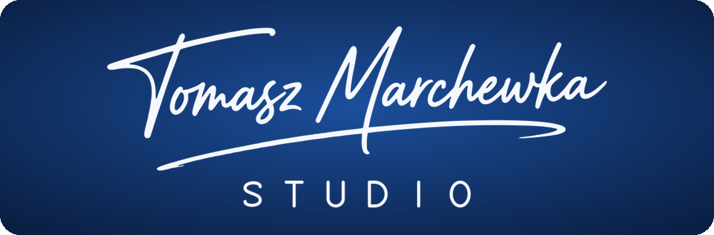

<h1 align="center">Hi, I'm Tomasz 👋</h1>

  <b>I build native macOS apps and games — fast, beautiful and private by design.</b> 
  Data stays on your Mac. Encrypted. GDPR-friendly. No accounts, no cloud, no tracking.

  
  
  
  

🌐 <a href="https://carrot79pl.github.io"><b>carrot79pl.github.io</b></a> — all downloads in one place · wszystkie programy w jednym miejscu

---

  

## ⬇️ Download my apps

| | App | What it does | Download |
|---|---|---|---|
| 🌀 | **[Fractal Explorer](https://github.com/Carrot79PL/fractal-explorer)** | Real-time fractal explorer. Deep zoom to 10²⁵×, 3D landscape, ambient music, 8K export. | [**Download**](https://github.com/Carrot79PL/fractal-explorer/releases/latest) |
| 🎲 | **[Samotnik](https://github.com/Carrot79PL/Samotnik)** | Calm 3D peg-solitaire. 60 solver-verified boards, photoreal materials, live-generated music. | [**Download**](https://github.com/Carrot79PL/Samotnik/releases/latest) |
| 🎱 | **[Bilard](https://github.com/Carrot79PL/Bilard)** | Native 3D pool: 8-ball, 9-ball, 10-ball, 14.1 and snooker, a menu printed on the cloth, daily challenges and trophies, photoreal graphics. | [**Download**](https://github.com/Carrot79PL/Bilard/releases/latest) |
| 📷 | **[Migawka](https://github.com/Carrot79PL/Migawka)** *(v0.5 beta)* | Secure photo, video and archive viewer. Opens ZIP/7z/RAR in RAM only, Touch ID lock. | [**Download**](https://github.com/Carrot79PL/Migawka/releases/latest) |
| 🗜️ | **[Archiwum](https://github.com/Carrot79PL/Archiwum)** *(v1.0.1)* | Fast native archive manager. 7z/ZIP/RAR/TAR, AES-256, RAM-disk previews that leave no traces. | [**Download**](https://github.com/Carrot79PL/Archiwum/releases/latest) |
| 🔐 | **[Skarbiec](https://github.com/Carrot79PL/Skarbiec)** | Encrypted vault for small-business accounts and app logins. Local, AES-256-GCM. | [**Download**](https://github.com/Carrot79PL/Skarbiec/releases/latest) |
| 🧹 | **[BlankSpace](https://github.com/Carrot79PL/BlankSpace)** *(v1.0)* | Secure free-space wiping and file shredder. Metal-generated random data, DoD and Gutmann levels, verification, schedule. | [**Download**](https://github.com/Carrot79PL/BlankSpace/releases/latest) |
| 📊 | **[Claude Usage Widget](https://github.com/Carrot79PL/claude-usage-widget)** | Desktop widget and report for your Claude plan limits, with forecast. Unofficial. | [**Download**](https://github.com/Carrot79PL/claude-usage-widget/releases/latest) |

> **Requirements:** macOS 14+ on Apple Silicon (Skarbiec also has an Intel build; Claude Usage Widget and Archiwum need macOS 26+). Free, no accounts.
>
> **First launch on macOS:** if macOS says the app can't be verified, right-click the app → **Open** → **Open**. You only need to do this once.

---

## 🌀 Fractal Explorer

  

Six fractal models, deep Mandelbrot zoom powered by perturbation theory on the GPU (Metal), band-free colours, a 3D landscape mode and generative ambient music that gets brighter the deeper you go.
🇵🇱 *Natywna eksploracja fraktali w czasie rzeczywistym: zoom do 10²⁵×, krajobraz 3D, muzyka ambient, eksport 8K.*

## 🎲 Samotnik

  

A relaxing 3D peg-solitaire with three difficulty levels, hints from a built-in solver, a random board generator and high-score tables. Written in pure Swift and SceneKit — no engine, no dependencies.
🇵🇱 *Spokojna gra logiczna 3D: 60 plansz, trzy poziomy trudności, samouczek, tabela rekordów.*

## 🎱 Bilard

  

  
  
  

A native 3D pool game with its own ball physics: 8-ball, 9-ball, 10-ball (call shot), straight pool and snooker, three AI levels, tournaments, replays, 20 cloths / rails / pocket fittings, 10 cues, cloth emblems, daily and weekly challenges with 35 trophies, HDR option. Pure Swift, SceneKit (Metal) and SwiftUI — no game engine, music and sounds synthesised in code.
🇵🇱 *Natywny bilard 3D z własną fizyką: ósemka, dziewiątka, dziesiątka z deklarowaniem zagrań, 14/1, snooker i tryb treningowy, trzy poziomy komputera, turnieje, powtórki, personalizacja (po 20 sukien, ram i łuz, 10 kijów, emblematy), wyzwania i trofea.* **Wersja 1.4.**

## 🔐 Skarbiec

  

For the person who "does IT" in a small company: employee accounts, passwords, licences and app logins in one encrypted vault. Syncs with Microsoft 365, checks password health (including privacy-preserving breach checks) and keeps an encrypted audit log.
🇵🇱 *Zaszyfrowany sejf na firmowe konta i dostępy. Bez chmury i bez serwera.*

## 🧹 BlankSpace

  

Overwrites the free space on a disk so deleted files can't be recovered, and shreds chosen files and folders. Six wipe levels (Quick, Standard, DoD 3-pass, Extended 7-pass, full Gutmann 35-pass, Custom), random data generated on the GPU with Metal, read-back verification, weekly schedule, menu-bar progress. Honest about SSD limits and points to FileVault. Pure Swift and SwiftUI, no network access.
🇵🇱 *Bezpieczne czyszczenie wolnego miejsca i niszczenie plików na macOS: sześć poziomów (od szybkiego po Gutmanna), dane losowe z GPU, weryfikacja, harmonogram. Uczciwie o ograniczeniach SSD.*

## 📷 Migawka

A viewer for sensitive photos, videos and archives — medical records, document scans, inspection photos. Archives are unpacked into RAM only, data is wiped on sleep or idle, and the app never touches the network (except the optional map).
🇵🇱 *Bezpieczna przeglądarka zdjęć, filmów i archiwów (RODO). Zawartość archiwów trafia tylko do pamięci RAM.*

## 🗜️ Archiwum

  
  

  
  

The 7-Zip experience, rebuilt as a native macOS app with a glass interface. Opens and creates 7z, ZIP, TAR.* and reads RAR/ISO and more, with AES-256 encryption, a size treemap, in-memory thumbnails and previews, duplicate finder, SHA-256 and Ed25519 signatures. Files you open from an archive live on a RAM disk that is zeroed and ejected afterwards, so nothing is left on your SSD. Finder integration: *Archiwizuj folder*, *Wypakuj tutaj*, drag files straight out of an archive.
🇵🇱 *Szybki, natywny menedżer archiwów dla macOS ze szklanym interfejsem: 7z/ZIP/TAR/RAR, szyfrowanie AES-256, mapa rozmiarów, podgląd i miniatury tylko w pamięci, wykrywanie duplikatów, podpisy cyfrowe. Pliki otwierane z archiwum trafiają na dysk RAM, który jest zerowany po użyciu — zero śladów na dysku. Integracja z Finderem (Archiwizuj folder, Wypakuj tutaj).*

## 📊 Claude Usage Widget

  

See how much of your Claude plan limit you've used (5-hour window and weekly), with a forecast, a daily budget and breakdowns by model and project.
🇵🇱 *Widget i aplikacja pokazujące zużycie limitów planu Claude, z prognozą. Narzędzie nieoficjalne.*

---

## 🔒 Principles

- **Your data stays on your device** unless you explicitly decide otherwise.
- **Encryption by default**, not as an option.
- **Native look and feel** on macOS.

🇵🇱 *Dane zostają na Twoim komputerze · szyfrowanie domyślnie · natywny wygląd i działanie na macOS.*

## 🛠️ Tech

## 📫 Contact

📍 Świecie, Poland · ✉️ [t.marchewka@airpress.pl](mailto:t.marchewka@airpress.pl)

*Found a bug or have an idea? Open an issue in the relevant repository — I read them all.*
🇵🇱 *Znalazłeś błąd albo masz pomysł? Zgłoś go w odpowiednim repozytorium.*
